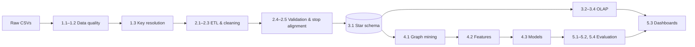

# Indian Railways Punctuality & Network Delay Dynamics

**Data Warehousing and Data Mining project** — an end-to-end knowledge-discovery pipeline over one year of Indian Railways passenger operations: data-quality audit → ETL → DuckDB star schema → OLAP cubes → railway-network graph mining → leakage-free next-station delay prediction → dashboards.

> Uplakshya Vishwakarma · M.Tech CSE (Artificial Intelligence) · Roll No. 26072011 · IIT (BHU) Varanasi

| | |
|---|---|
| **Period** | 8 Feb 2025 – 7 Feb 2026 (365 days) |
| **Raw data** | 38,428,703 station-level delay records · 172,112 timetable stops · 8,992 train rows · 8,963 stations |
| **Warehouse** | 36,614,824-row fact table · 8,720 trains · 9,027 stations · 365 dates |
| **Prediction set** | 33,158,834 observed transitions, chronological 80 / 10 / 10 split |
| **Best model** | Random Forest — test MAE **6.68 min**, RMSE **17.59 min**, R² **0.932** (MSE −24.2 % vs persistence) |

Full write-up: **[`results/FINAL_PROJECT_REPORT.md`](results/FINAL_PROJECT_REPORT.md)** · Slides: **[`presentation/`](presentation/)**

---

## Key findings

1. **Delay is made on the line, not at the origin.** 86.6 % of trains leave their origin within 15 min; only 47.4 % of later stops are reached within 15 min.
2. **Delay grows along the route, then the timetable hides it.** Mean delay climbs from 10.7 min (origin) to 69.7 min (stop 36+), then falls to 28.2 min at the terminus, where **31.6 %** of arrivals are early — recovery time is concentrated on the last segment.
3. **Stress is regional.** SECR, SER, NER and ECR have 6–8 % of stops beyond 167.65 min (2σ); WR, SR and SWR stay below 1 %.
4. **Winter is the worst season.** December 2025 peaks at 45.0 min mean delay and 5.41 % bottleneck rate; August 2025 is best (31.0 min, 2.56 %). Weekday barely matters.
5. **Special trains are the least punctual.** PRM/special-tagged services average ~96 min (17.4 % bottleneck) — 2.6× regular Express trains.
6. **Bottleneck hubs and corridors.** Composite structural + operational stress ranks **KGP, NGP, TATA, BJU, BSL** highest; corridors such as **KGP → SRC (+39.8 min/run)**, NDLS → CNB and HWH → BWN amplify delay on 70–95 % of runs. DDU, BZA, NGP, CNB and NDLS are the main structural bridges (betweenness).
7. **Once late, trains stay late.** Stop-to-stop delay correlation is r = 0.96; 99.7 % of trains in the bottleneck state are still > 15 min late at the next stop.
8. **Prediction.** Random Forest beats the persistence baseline by 18.6 % MAE and 24.2 % MSE on unseen winter data; the learned models remove persistence's +12.7-min bias at terminal stops. A response-curve audit shows XGBoost's forecast is flat at 689 min for any current delay above 435 min, which explains its poor critical-tail error.

---

## Repository layout

```
indian_railway_delay/
├── README.md
├── requirements.txt
├── Definition_and_Description.txt     problem definition submitted for the course
├── evaluation_on_halfway.txt          mid-term progress note
├── documentation.txt                  dated lab notebook of every step and result
├── predictor.py                       Streamlit multi-stop (recursive) predictor — needs the full results/ files
├── analysis/                          one notebook per pipeline step (step01_01 … step05_03) + step05_04 audit script
├── results/
│   ├── FINAL_PROJECT_REPORT.md        final report
│   ├── step*_FINDINGS.json            machine-readable findings of every step (used by the dashboards)
│   ├── step04_02_preprocessing_artifacts.json   feature list, priors, scaler parameters
│   ├── step05_04_model_response_curves.json     response-curve audit output
│   ├── figures/                       all static figures (PNG)
│   └── models/                        trained Ridge (.joblib), Random Forest (.joblib), XGBoost (.json)
├── dashboard/
│   ├── app.py                         interactive Streamlit dashboard (7 pages + live predictor)
│   ├── build_dashboard_html.py        generator for the standalone HTML dashboard
│   └── indian_railways_dashboard.html standalone executive dashboard (open in a browser)
└── presentation/                      project presentation (.pptx)
```

Large intermediates produced by the notebooks — cleaned CSVs, `fact_delay.parquet` (≈ 432 MB), feature parquets and DuckDB files — are **not committed**. The JSON findings, figures and trained models are, so the dashboards and report work on a fresh clone.

---

## Pipeline



| Step | Notebook | What it does |
|---|---|---|
| 1.1–1.2 | `step01_01/02_data_quality` | Profiling, missing values, key uniqueness, referential integrity |
| 1.3 | `step01_03_5_key_resolutions` | Resolves 272 duplicate train numbers (PRM overlay → flag), adds 64 unknown stations, verifies the fact grain globally |
| 2.1 | `step02_01_ETL_cleaning` | Address constant, zero-halt schedule imputation, proves `delay` = departure delay at origin / arrival delay elsewhere |
| 2.2 | `step02_02_ETL_cleaning` | Drops 39,616 phantom journeys, per-train median at origin, LOCF en route, `is_imputed` provenance |
| 2.3 | `step02_03_ETL_cleaning` | 1,440-min noise cutoff, 2σ / 3σ bottleneck bands, `dim_date` hierarchy |
| 2.4 | `step02_04_consistency_checks` | Join integrity; shows `date` is the journey start date |
| 2.5 | `step02_05_alignment_diagnosis` | `stop_alignment_map` fixes 18 % shifted stop numbers (97.66 % aligned) |
| 3.1 | `step03_01_build_star_schema` | Fact + 3 dimensions in DuckDB, Parquet export, 8 validation checks |
| 3.2 | `step03_02_analytical_views` | Reusable OLAP views and denominators |
| 3.3 | `step03_03_olap_cubes` | Category, zone, station, temporal cubes; zone × category cuboid |
| 3.4 | `step03_04_pattern_discovery` | Origin vs arrival, route progression, terminal padding, diurnal cycle, amplification, imputation audit |
| 4.1 | `step04_01_network_bottleneck_analysis` | Schedule graph, betweenness, composite hub score, edge amplification, propagation |
| 4.2 | `step04_02_prediction_dataset` | 12 leakage-free features with empirical-Bayes priors, chronological split |
| 4.3 | `step04_03_delay_prediction_models` | Persistence, Ridge, Random Forest, XGBoost; tuning on validation |
| 5.1 | `step05_01_independent_model_evaluation` | MSE / RMSE / MAE / R² on the untouched test set, stratified |
| 5.2 | `step05_02_pattern_evaluation` | Out-of-time persistence of bottlenecks, imputation effects |
| 5.3 | `step05_03_visual_dashboard` | Original dashboard export |
| 5.4 | `step05_04_model_response_audit.py` | Probes the saved models; explains XGBoost's tail failure |

---

## Quick start

```bash
git clone https://github.com/uplakshya07/indian_railway_delay.git
cd indian_railway_delay
python -m venv .venv && source .venv/bin/activate      # Windows: .venv\Scripts\activate
pip install -r requirements.txt
```

### Dashboards (work out of the box)

```bash
# Interactive dashboard with a live predictor that runs all four trained models
streamlit run dashboard/app.py

# Standalone HTML dashboard: just open the file in a browser
open dashboard/indian_railways_dashboard.html          # or double-click it
python dashboard/build_dashboard_html.py               # regenerate it from results/*.json
python dashboard/build_dashboard_html.py --inline      # embed Plotly.js for fully offline use
```

| Streamlit page | Contents |
|---|---|
| 1 · Overview & data pipeline | KPIs, ETL row funnel, origin vs en-route contrast, resolved data-quality issues |
| 2 · Punctuality cubes | Category / zone roll-ups with a measure switch, zone scatter, special-train drill-down, zone × category cuboid, station tables |
| 3 · Temporal patterns | Monthly trajectory, bottleneck rate, weekday, time of day, zone stability across splits |
| 4 · Route progression | Route stages, terminal padding, distance bands, amplifying vs recovering stations |
| 5 · Network bottlenecks | Graph statistics, composite hubs, betweenness, amplifying corridors, propagation, persistence |
| 6 · Model evaluation | Train/val/test metrics, error bands, severity / stop-context / category breakdowns, response-curve audit, feature importance, tuning log |
| 7 · Live delay predictor | Enter live delays and segment features (or pick a corridor preset) → forecasts from Persistence, Ridge, Random Forest and XGBoost, what-if curve and Ridge contribution breakdown |

### Reproducing the analysis

1. Download the [Indian Railways Delay Dataset](https://www.kaggle.com/datasets/rxydenxd/indian-railways-delay-dataset) and place the four CSVs in `data_sets/`:
   `train_details.csv`, `station_full_names.csv`, `combined_schedule.csv`, `combined_delay.csv` (≈ 900 MB).
2. Run the notebooks in `analysis/` in step order (`step01_01` → `step05_03`). DuckDB processes the 38 M-row table out of core; 16 GB RAM is comfortable.
3. Run the audit: `python analysis/step05_04_model_response_audit.py`.
4. With the full `results/` in place, `streamlit run predictor.py` gives multi-stop route forecasts for a real train number.

---

## Methods at a glance

| Area | Techniques |
|---|---|
| Preprocessing | Entity identification, unknown dimension members, global-constant / logical / class-median / LOCF imputation with provenance flags, domain noise cutoff, positive-tail σ outlier bands, concept hierarchies |
| Warehouse | Star schema, journey-date grain, distributive / algebraic / holistic measures, ROLAP on DuckDB, Parquet materialisation |
| OLAP | Roll-up, drill-down (special-train flag), slice (≥ 1,000-stop stations), dice (zone × category cuboid) |
| Graph mining | Directed schedule graph (8,629 nodes, 31,514 edges), exact Brandes betweenness, connected components, percentile-rank composite score, edge-level delay deltas, lag autocorrelation |
| Prediction | Persistence baseline, Ridge (α = 10), Random Forest (80 trees, depth 14), XGBoost (hist, early stopping); empirical-Bayes smoothed priors (m = 50); chronological holdout; MAE / MSE / RMSE / R²; stratified and residual diagnostics |

---

## Results summary (untouched test set, 2 Jan – 7 Feb 2026, n = 3,351,989)

| Model | MSE (min²) | RMSE (min) | MAE (min) | R² | Within ±15 min |
|---|---:|---:|---:|---:|---:|
| Persistence | 408.14 | 20.20 | 8.21 | 0.9106 | 84.41 % |
| Ridge (α = 10) | 324.33 | 18.01 | 7.17 | 0.9290 | 88.16 % |
| **Random Forest** | **309.26** | **17.59** | **6.68** | **0.9323** | 89.45 % |
| XGBoost | 429.87 | 20.73 | 7.06 | 0.9058 | **89.61 %** |

---

## Limitations

One annual cycle (validation and test both fall in winter), scraped rather than operator data, no weather / freight / maintenance inputs, one-step forecast horizon, and models trained on sub-samples for memory reasons. See Section 13 of the report.

## References

The main texts are Han, Kamber & Pei, *Data Mining: Concepts and Techniques* (3rd ed., 2012) and Kimball & Ross, *The Data Warehouse Toolkit* (3rd ed., 2013); the full list is in the report.

## Data source

RXYDENXD, *Indian Railways Delay Dataset*, Kaggle — scraped from etrain.info (NTES mirror). Used for academic purposes.
