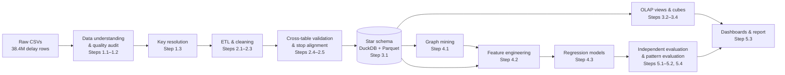
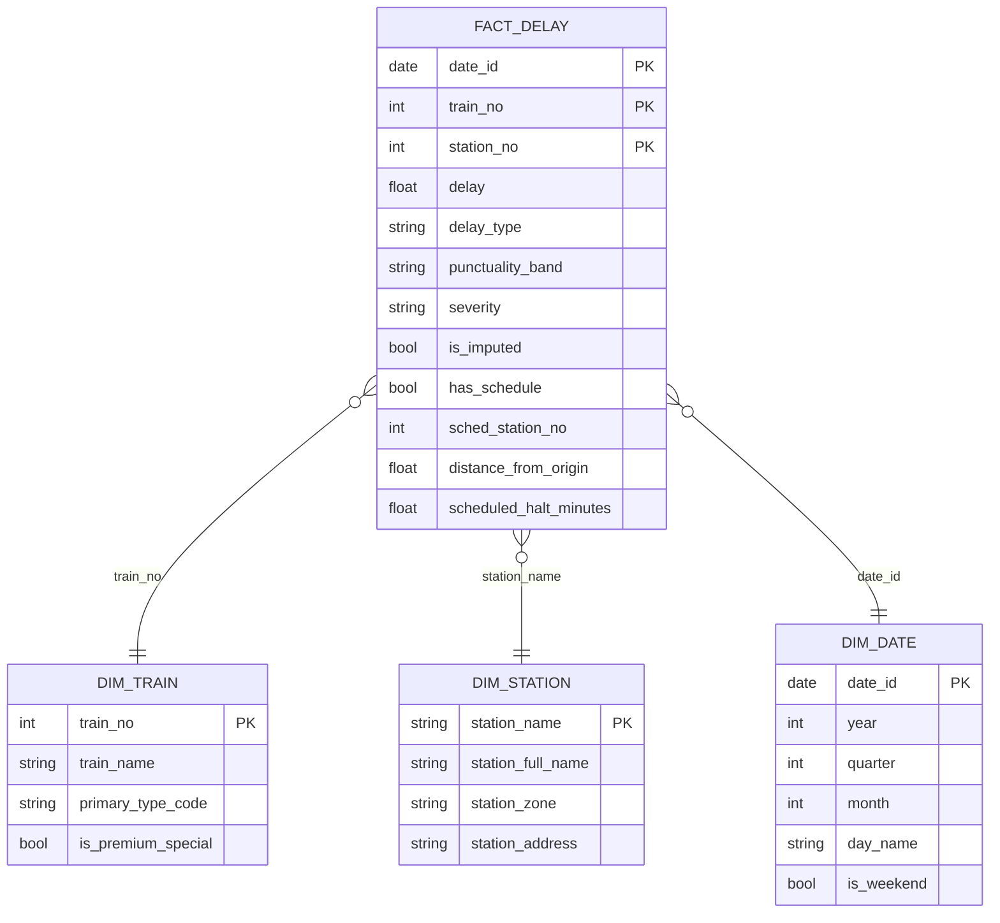
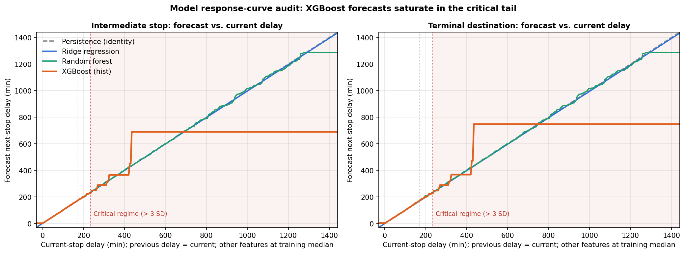

# Indian Railways Punctuality & Network Delay Dynamics Analysis

### Data Warehousing, OLAP, Network Mining and Next-Station Delay Prediction on One Year of Operational Data

**Final Project Report — Data Warehousing and Data Mining**

| | |
|---|---|
| **Student** | Uplakshya Vishwakarma |
| **Programme** | M.Tech, Computer Science & Engineering (Artificial Intelligence) |
| **Roll No.** | 26072011 |
| **Institute** | Indian Institute of Technology (BHU), Varanasi |
| **Date** | 6 November 2026 |
| **Repository** | https://github.com/uplakshya07/indian_railway_delay |

---

## Abstract

Train delays on Indian Railways rarely stay local: a few minutes lost at one junction are carried, and often amplified, along every remaining stop of a run. This project builds an end-to-end knowledge-discovery pipeline over a full year of passenger-train operations (8 Feb 2025 – 7 Feb 2026; 38.43 million raw station-level delay records for 7,033 trains) to answer three questions: *when and for whom is the network unpunctual, where are the structural bottlenecks, and how well can the next station's delay be forecast?*

The raw data was audited, key-resolved and cleaned with domain rules (context-dependent delay semantics, origin-date-aware imputation with provenance flags, a 24-hour noise cutoff and a stop-sequence alignment map), then loaded into a DuckDB star schema of **36,614,824** fact rows linked to train, station and date dimensions. OLAP roll-ups, drill-downs and 2-D cuboids show that trains leave their origin on time **86.6 %** of the time but arrive on time at only **47.4 %** of later stops; delay grows monotonically along the route (10.7 → 69.7 min mean) before collapsing at the terminal, where **31.6 %** of arrivals are early because schedule slack is concentrated on the last segment. Graph mining of the 8,629-station schedule network identifies bridge junctions (DDU, BZA, NGP, CNB, NDLS) and composite congestion hubs (KGP, NGP, TATA, BJU, BSL), mostly on the coal-and-mineral belt of SER, SECR and ECR.

For prediction, 33.16 million leakage-free observed transitions were split chronologically (80/10/10) and four regressors were compared. A **Random Forest** gives the best untouched-test performance (**MAE 6.68 min, RMSE 17.59 min, R² 0.932**), cutting MSE by **24.2 %** and MAE by **18.6 %** against the persistence baseline, with 89.5 % of forecasts within ±15 min. A new response-curve audit of the saved models explains XGBoost's failure in the critical tail: its forecast is flat at 689 min for any current delay above 435 min.

---

## Table of Contents

1. [Introduction and Objectives](#1-introduction-and-objectives)
2. [Dataset](#2-dataset)
3. [Methodology and System Architecture](#3-methodology-and-system-architecture)
4. [Data Understanding and Quality Assessment](#4-data-understanding-and-quality-assessment-steps-1112)
5. [Key Resolution, ETL and Data Cleaning](#5-key-resolution-etl-and-data-cleaning-steps-1325)
6. [Data Warehouse Design](#6-data-warehouse-design-steps-3132)
7. [Multidimensional OLAP Analysis](#7-multidimensional-olap-analysis-steps-3334)
8. [Railway Network Mining and Bottleneck Analysis](#8-railway-network-mining-and-bottleneck-analysis-step-41)
9. [Delay Prediction](#9-delay-prediction-steps-4243)
10. [Independent Evaluation and Pattern Evaluation](#10-independent-evaluation-and-pattern-evaluation-steps-5154)
11. [Visual Dashboards](#11-visual-dashboards-step-53)
12. [Discussion: Insights and Operational Recommendations](#12-discussion-insights-and-operational-recommendations)
13. [Limitations and Threats to Validity](#13-limitations-and-threats-to-validity)
14. [Future Work](#14-future-work)
15. [Conclusion](#15-conclusion)
16. [References](#16-references)
17. [Appendix A — Reproducibility Map](#appendix-a--reproducibility-map)
18. [Appendix B — Changes from the Previous Report Version](#appendix-b--changes-from-the-previous-report-version)

---

## 1. Introduction and Objectives

Indian Railways runs one of the world's largest passenger networks. Its operational data — timetables, station masters and actual arrival/departure logs — is generated continuously, but delays cascade across densely shared corridors, so a local disruption becomes a network problem. The aim of this project is to turn a year of these logs into decision-ready knowledge.

**Objectives**

| # | Objective | Data-mining task | Main techniques |
|---|---|---|---|
| O1 | **Punctuality and temporal patterns** — characterise delay by month, weekday, time of day, route stage and train category | Descriptive mining / OLAP | Star schema, roll-up, drill-down, slice/dice, 2-D cuboids |
| O2 | **Bottleneck and high-risk route identification** — find stations and sections that trigger or amplify delay | Graph mining, outlier analysis | Directed schedule graph, betweenness centrality, composite ranking, transition deltas, 2σ/3σ outlier bands |
| O3 | **Delay prediction** — forecast the arrival delay at the next scheduled station | Numeric prediction (regression) | Persistence baseline, Ridge, Random Forest, XGBoost with chronological holdout |

The pipeline follows the Knowledge Discovery in Databases (KDD) process — cleaning, integration, selection, transformation, mining, pattern evaluation and knowledge presentation — as described by Han, Kamber and Pei [1, Ch. 1] and Fayyad et al. [6].

---

## 2. Dataset

**Source:** *Indian Railways Delay Dataset*, Kaggle (user RXYDENXD) [21], scraped from etrain.info, which mirrors the National Train Enquiry System (NTES). Coverage: **365 days, 8 Feb 2025 – 7 Feb 2026**.

| Table | Rows | Grain | Key attributes |
|---|---:|---|---|
| `train_details.csv` | 8,992 | one row per train × type tag | `train_no`, `train_name`, `type_code` |
| `station_full_names.csv` | 8,963 | one row per station | `station_name`, `station_full_name`, `station_zone`, `station_address` |
| `combined_schedule.csv` | 172,112 | one row per train × scheduled stop | `train_no`, `station_no`, `station_name`, `distance_from_origin`, `arrival_day/time`, `departure_day/time` |
| `combined_delay.csv` | 38,428,703 | one row per date × train × stop | `date`, `train_no`, `station_no`, `station_name`, `delay` (minutes) |

**Attribute types** (following [1, Ch. 2]): `train_no`, `station_name`, `type_code`, `station_zone` are *nominal*; `station_no` is *ordinal* (stop sequence, not a physical station); `distance_from_origin` and `delay` are *ratio-scaled numeric* (negative delay = early arrival); scheduled times and days are *interval-scaled*; `date` is temporal.

**Train categories (`type_code`):** PASS (passenger), EXP (express), SF (superfast), RAJ (Rajdhani), SHT (Shatabdi), T18 (Vande Bharat / Namo Bharat), GRB (Garib Rath) and PRM (premium / special overlay tag).

---

## 3. Methodology and System Architecture

### 3.1 Pipeline

| KDD stage [1, 6] | Project steps | Han & Kamber reference |
|---|---|---|
| Data cleaning | 1.1–1.3, 2.1–2.3 | Ch. 3 (missing values, noise, outliers) |
| Data integration | 1.3, 2.4–2.5 | Ch. 3 (entity identification, redundancy, value conflicts) |
| Data selection & transformation | 2.3, 3.1, 4.2 | Ch. 3 (concept hierarchies, normalisation); Ch. 4 |
| Data warehousing & OLAP | 3.1–3.4 | Ch. 4–5 |
| Data mining | 4.1–4.3 | Ch. 8 (prediction, ensembles), Ch. 12 (outliers); graph centrality [8, 9, 10] |
| Pattern evaluation | 5.1–5.2, 5.4 | Ch. 8 (evaluation, holdout) |
| Knowledge presentation | 5.3 | Ch. 4 (OLAP presentation) |

### 3.2 Technology stack

| Concern | Tool | Why |
|---|---|---|
| Out-of-core SQL over 38 M rows | **DuckDB** [15] | Columnar, vectorised, runs on a laptop; window functions for LOCF and lags |
| Storage | Parquet (fact table 431.97 MB), CSV dimensions | Compressed columnar format for repeated scans |
| Dataframes | pandas, NumPy | Small dimensions and result tables |
| Graph mining | NetworkX [16] | Exact Brandes betweenness, components |
| Models | scikit-learn [17] (Ridge, Random Forest), XGBoost [12] | Standard, reproducible implementations |
| Presentation | Streamlit, Plotly, Matplotlib | Interactive and static dashboards |

---

## 4. Data Understanding and Quality Assessment (Steps 1.1–1.2)

| Check | Finding | Implication |
|---|---|---|
| Complete-duplicate rows | 0 in all four tables (delay table first scanned in chunks) | Global grain check still needed → Step 1.3 |
| Missing values | `station_address` 94; `arrival_time` 8,673 and `departure_time` 8,673 (5.04 %); `delay` **1,874,271 (4.88 %)** | Missingness must be handled per attribute |
| Structure of delay missingness | Not random: whole stations dark for the year (e.g. AJLE 365/365, STLA 365/365, KCVL 9,107/9,281); dates in Feb 2025 at 12–14 % missing (25 Feb: 13.59 %) | Cannot zero-fill; needs journey-aware imputation |
| Key uniqueness | `train_no` not unique: 8,992 rows, 8,720 unique; 272 numbers carry two `type_code`s (base type + PRM overlay) | Train dimension key must be resolved |
| Schedule structure | 119 distinct `station_no` but 8,629 distinct `station_name` | `station_no` is route position, not physical station |
| Referential integrity | 1 schedule station and 63 delay stations missing from station master; 1,687 trains in master never appear in delay logs | Unknown members must be added, not dropped |
| Candidate grain | `(date, train_no, station_no)` unique within chunks | Verify globally |

---

## 5. Key Resolution, ETL and Data Cleaning (Steps 1.3–2.5)

### 5.1 Summary of preprocessing decisions

| Issue | Technique (concept in [1, Ch. 3]) | Result |
|---|---|---|
| 272 duplicate `train_no` | **Entity identification**: base service type kept as `primary_type_code`; PRM tag converted to boolean `is_premium_special`; 4 Namo Bharat rows manually set to T18 | 8,720-row conflict-free train dimension |
| 64 stations not in master | **Unknown dimension members** appended with `"UNKNOWN"` metadata | 9,027-station dimension, 100 % FK integrity |
| Fact grain ambiguity | Global `GROUP BY … HAVING COUNT(*) > 1` in DuckDB over all 38.4 M rows | 0 duplicates → grain `(date, train_no, station_no)` |
| 94 missing addresses | **Global constant** for nominal attribute | `"UNKNOWN"` + `is_address_imputed` flag |
| 8,673 + 8,673 missing schedule times | **Logical (domain) imputation** — "zero-halt" rule: missing only at origin arrivals and terminal departures | Origin arrival := departure; terminal departure := arrival |
| Meaning of `delay` | **Hypothesis test at route boundaries**: 1,038,047 non-zero delays at origin, 1,044,006 at destination | `delay` = departure delay at `station_no = 1`, arrival delay at `station_no > 1` |
| Fully dark journeys | **Ignore the tuple** (journey-level), grouped by `origin_date = date − (arrival_day − 1)` | 39,616 phantom journeys / 1,787,907 rows dropped |
| Missing origin delays | **Central tendency of the same class** — per-train median, global median fallback | 42,392 origins imputed |
| Mid-route blackouts | **Most probable value (spatio-temporal LOCF)** — `LAST_VALUE … IGNORE NULLS` per `(origin_date, train_no)` | 990,514 values filled; 10,990 leading orphans dropped |
| Impossible values (max 525,592 min ≈ 365 days) | **Noise removal** with a domain cutoff — 1,440 min (24 h rescheduling limit) | 14,982 rows removed; SD falls from 229.88 to 66.03 min |
| Genuine extremes | **Outlier analysis** [1, Ch. 12] — keep, label with positive-tail dispersion bands | High-risk > 167.65 min (2σ); critical > 233.68 min (3σ) |
| Early arrivals (609,727 rows, min −120 min) | Domain validation | Retained (valid schedule recovery) |
| Time hierarchy | **Concept hierarchy generation** | `dim_date`: day → weekday/weekend → month → quarter → year |

Every synthetic value carries `is_imputed = TRUE`; imputed rows are **never used as prediction targets**.

### 5.2 Final cleaned fact table

| Quantity | Value |
|---|---:|
| Raw delay rows | 38,428,703 |
| After phantom-journey drop, imputation and orphan drop | 36,629,806 |
| After 1,440-min noise cutoff (**final**) | **36,614,824** |
| Observed rows | 35,582,318 (97.18 %) |
| Imputed rows | 1,032,506 (2.82 %) |
| Delay range | −120 to 1,440 min |
| Mean / SD (all cleaned rows) | 35.60 / 66.03 min |
| High-risk (2σ–3σ, 167.65–233.68 min) | 613,515 rows |
| Critical (> 3σ, > 233.68 min) | 659,943 rows |
| **Bottleneck total (> 2σ)** | **1,273,458 rows (3.48 %)** |

Because delays are bounded on the left (−120 min ≈ the −2σ point of −96.5 min) and unbounded on the right, the 2σ/3σ bands are applied to the positive tail only.

### 5.3 Cross-table validation (Step 2.4)

- **Key uniqueness and join integrity:** 0 duplicate keys in either table; the delay ⟕ schedule join preserves all 36,614,824 rows (no fan-out).
- **What does `date` mean?** For multi-day trains it could be the calendar date at each stop or the journey start date. The demeaned origin-delay on date *D* was correlated with the terminal delay on *D + k*. The correlation peaks at **k = 0** for every journey length (1-day r = 0.472, 2-day 0.613, 3-day 0.526, 4-day 0.436), so **`date` is the journey origin date** for every stop. No date shifting was needed.
- **Imputation provenance:** 0 discrepancies between `is_imputed` and raw nulls.

### 5.4 Stop-sequence alignment (Step 2.5)

Joining delay to schedule on `(train_no, station_no)` matched the station name in only 81.99 % of rows. The cause: the delay logs contain extra intermediate halts not in the static timetable, pushing later `station_no` values forward (62.7 % of shifted rows are off by exactly −1).

| Class | Stops | Rows | Share of rows |
|---|---:|---:|---:|
| Exact match | 112,948 | 30,018,784 | 81.99 % |
| Shifted (same station, different position) | 24,495 | 5,737,461 | 15.67 % |
| Station not in that train's schedule | 4,203 | 858,579 | 2.34 % |

`stop_alignment_map.csv` re-points shifted stops to the correct scheduled position (0 ambiguous matches, 0 collisions). **35,756,245 rows (97.66 %)** carry aligned schedule attributes; the remaining 858,579 are kept with `has_schedule = FALSE`. Rule carried forward: *schedule features are joined only through the alignment map, never on raw `station_no`.*

---

## 6. Data Warehouse Design (Steps 3.1–3.2)

### 6.1 Star schema

- **Grain:** one delay observation per *(journey start date, train, stop position)* — 36,614,824 rows.
- **Dimensions:** `dim_train` 8,720; `dim_station` 9,027; `dim_date` 365.
- **Derived attributes:** `punctuality_band` (early/on-time ≤ 0, within 15 min, delayed > 15 min); `severity` (normal / high-risk / critical); `delay_type` (departure at origin, arrival elsewhere).
- **Measures** (per [1, Ch. 4]): counts and sums are *distributive*, mean and rates are *algebraic*, median, IQR and P90/P95 are *holistic*. Holistic measures cannot be rolled up from sub-aggregates, so the cube is computed **ROLAP-style on demand** in DuckDB rather than fully materialised.
- **Physical design:** the enriched fact table is materialised once as `fact_delay.parquet` (431.97 MB) to avoid repeating the alignment join; `olap_star_schema` is a view joining all dimensions.
- **Validation:** eight automated checks (row conservation, schedule coverage, provenance counts, distance completeness, station/train/date referential integrity, bottleneck count) — **all passed**.

### 6.2 Analytical views and denominators (Step 3.2)

| View | Filter | Rows |
|---|---|---:|
| `vw_olap_observed` (default) | `is_imputed = FALSE` | 35,582,318 |
| `vw_olap_observed_arrival` | observed, `station_no > 1` | 33,773,361 |
| `vw_olap_observed_origin` | observed, `station_no = 1` | 1,808,957 |
| `vw_olap_prediction_eligible` | observed, `has_schedule = TRUE` | 35,279,998 |
| `vw_olap_schedule_missing` | `has_schedule = FALSE` | 858,579 |

**Origin vs en-route contrast (observed):**

| Context | Rows | Mean | Median | On-time ≤ 15 min | Bottleneck > 2σ |
|---|---:|---:|---:|---:|---:|
| All stops | 35,582,318 | 35.68 | 16 | 49.36 % | 3.47 % |
| Origin departures | 1,808,957 | 10.73 | 1 | **86.56 %** | 1.04 % |
| En-route arrivals | 33,773,361 | 37.01 | 17 | **47.36 %** | 3.60 % |

Delay is overwhelmingly **generated en route**, not at the origin.

---

## 7. Multidimensional OLAP Analysis (Steps 3.3–3.4)

All figures below use observed records (`is_imputed = FALSE`). Bottleneck = share of stops with delay > 167.65 min.

### 7.1 Cube 1 — Train category (roll-up to `primary_type_code`)

| Category | Observed stops | Share | Mean (min) | Median | P90 | On-time ≤ 15 | Bottleneck |
|---|---:|---:|---:|---:|---:|---:|---:|
| PASS | 17,519,157 | 49.24 % | 32.41 | 15 | 86 | 51.58 % | 2.51 % |
| EXP | 12,605,410 | 35.43 % | 37.14 | 18 | 87 | 46.29 % | 3.74 % |
| SF | 4,690,135 | 13.18 % | 43.68 | 17 | 105 | 46.98 % | 6.00 % |
| T18 (Vande Bharat) | 321,670 | 0.90 % | **14.71** | 6 | 33 | 73.11 % | 0.99 % |
| PRM (specials) | 148,417 | 0.42 % | **96.33** | 20 | 316 | 44.83 % | **17.40 %** |
| RAJ (Rajdhani) | 111,095 | 0.31 % | 31.64 | 9 | 65 | 63.47 % | 4.07 % |
| SHT (Shatabdi) | 94,495 | 0.27 % | 14.83 | 6 | 30 | **76.20 %** | 1.11 % |
| GRB (Garib Rath) | 91,939 | 0.26 % | 51.44 | 17 | 127 | 48.21 % | 7.53 % |

- Short-haul daytime premium services (SHT, T18) are the most punctual; holiday/seasonal specials are the least.
- **Drill-down on `is_premium_special`:** the 28 special-tagged Express trains average **95.11 min** (15.19 % bottleneck) against **36.83 min** (3.68 %) for regular Express trains. The PRM overlay — resolved in Step 1.3 rather than discarded — is one of the strongest single signals in the warehouse.

### 7.2 Cube 2 — Railway zone (roll-up to `station_zone`)

| Zone | Observed stops | Mean | Median | On-time ≤ 15 | Bottleneck |
|---|---:|---:|---:|---:|---:|
| SECR | 1,285,594 | 57.82 | 30 | 35.97 % | **7.74 %** |
| SER | 1,492,985 | 53.93 | 18 | 47.58 % | **7.71 %** |
| NER | 1,900,489 | 45.86 | 16 | 49.58 % | 6.43 % |
| ECR | 3,766,394 | 52.44 | 29 | 34.79 % | 5.94 % |
| WCR | 1,379,190 | 45.10 | 22 | 39.83 % | 5.22 % |
| … | | | | | |
| NWR | 2,080,927 | 19.12 | 10 | 63.29 % | 1.02 % |
| WR | 2,609,114 | **14.48** | 7 | **72.77 %** | 0.89 % |
| SR | 3,399,071 | 16.04 | 9 | 66.47 % | 0.74 % |
| SWR | 1,657,982 | 18.80 | 11 | 60.19 % | **0.58 %** |

(SCOR excluded: only 46 observed stops.) Stress concentrates in the eastern and central coal/mineral-freight belt (SECR, SER, ECR) and the dense north-eastern Gangetic corridor (NER); the western and southern zones run with an order of magnitude fewer extreme delays.

### 7.3 Cube 3 — Station level (slice: ≥ 1,000 observed stops/year; 7,076 stations, 98.02 % of traffic)

**Major hubs (≥ 25,000 stops):** TATA Tatanagar Jn (SER) 18.87 % bottleneck, mean 88.40 min · G Gondia Jn (SECR) 15.63 % · KGP Kharagpur Jn (SER) 15.43 % · GKP Gorakhpur Jn (NER) 13.44 % · BSP Bilaspur Jn (SECR) 13.21 %, followed by CPR, BJU, BSL, BLS, AK and NGP (all ≈ 10 %).

**Smaller stations with the highest bottleneck rates:** CTHR Chitahra (WCR) 32.07 %, TKYR Tikaria (WCR) 29.97 %, SWR Sonua (SER) 29.61 %, SAGM Sagma (WCR) 29.05 %, PRZ Parsa (NER) 28.99 %; SRC Santragachi Jn (SER, 17,415 stops) stands out at 27.48 %.

*Data-quality note:* the most "punctual" stations (Matheran hill line, Darjeeling Himalayan line) report a constant 0-minute delay for every run, which more likely reflects how these heritage lines are tracked than true perfect punctuality.

### 7.4 Cube 4 — Temporal hierarchy (roll-up month → quarter; drill-down to weekday)

| Period | Mean | Median | On-time ≤ 15 | Bottleneck |
|---|---:|---:|---:|---:|
| **Best month:** Aug 2025 | 31.02 | 14 | 52.38 % | 2.56 % |
| Apr 2025 | 31.43 | 14 | 53.02 % | 2.67 % |
| Nov 2025 | 37.21 | 18 | 46.71 % | 3.58 % |
| **Worst month:** Dec 2025 | **44.97** | 20 | 43.92 % | **5.41 %** |
| Jan 2026 | 40.19 | 20 | 43.64 % | 4.15 % |
| Q3 2025 (Jul–Sep) | 31.90 | 14 | 51.89 % | 2.77 % |
| Q1 2026 (Jan–Feb 7) | 39.81 | 19 | 43.92 % | 4.08 % |

- Performance deteriorates from November and peaks in **December–January**, consistent with North-Indian winter fog and holiday traffic.
- **Weekday is nearly irrelevant:** means range only 35.17 (Tue) – 36.18 min (Fri); medians are 16 min every day except Sunday (15). Consistent with this, weekday is not among the prediction features.

### 7.5 Cube 5 — Zone × Category 2-D cuboid (dice)

- **Worst cells (≥ 1,000 stops):** PRM in SER (mean 309.9 min, **50.3 %** bottleneck), PRM in NER (169.9 min, 36.3 %), PRM in ECR (186.3 min, 35.9 %). Among regular categories, SF in SER (97.5 min, 19.6 %) and SF in SECR (87.0 min, 17.9 %) are the largest systemic stress corridors.
- **Best cells:** T18 in WR/SWR/SR and SHT in SR/SWR (< 0.15 % bottleneck); PASS in WR (78.1 % on-time) and SR (76.5 %).

### 7.6 Route progression and the terminal-padding discovery (Step 3.4)

| Route stage | Observed stops | Mean | Median | Early (< 0) | On-time ≤ 15 | Bottleneck |
|---|---:|---:|---:|---:|---:|---:|
| Origin (stop 1) | 1,808,957 | 10.73 | 1 | 0.01 % | 86.56 % | 1.04 % |
| Stops 2–5 | 6,922,471 | 20.69 | 9 | 0.00 % | 66.69 % | 1.46 % |
| Stops 6–10 | 7,518,373 | 30.06 | 16 | 0.00 % | 49.60 % | 2.14 % |
| Stops 11–20 | 9,716,552 | 39.35 | 22 | 0.00 % | 40.02 % | 3.20 % |
| Stops 21–35 | 5,531,805 | 52.56 | 28 | 0.00 % | 34.13 % | 5.86 % |
| Stops 36+ | 2,234,286 | **69.65** | 35 | 0.00 % | 30.57 % | **10.98 %** |
| **Terminal (final stop)** | 1,849,874 | **28.15** | **6** | **31.61 %** | **64.38 %** | 4.01 % |

Delay accumulates monotonically along the route, then **falls sharply at the final stop** (mean 28.2 min, median 6 min), where almost a third of arrivals are early while intermediate stops record essentially none. This is direct evidence that Indian Railways places its schedule recovery time (slack) on the last segment before the terminus. The same effect drives distance: mean arrival delay rises from 25.6 min (≤ 100 km from origin) to **92.3 min beyond 1,500 km** (bottleneck 17.6 %).

### 7.7 Diurnal pattern

Early-morning arrivals (04:00–07:59) are the most punctual (mean 30.4 min, 54.4 % on time). Delay builds through the day and peaks **late at night (00:00–03:59: mean 43.6 min, bottleneck 4.97 %)**, reflecting accumulated knock-on delays and overnight freight and maintenance blocks.

### 7.8 Station-level amplification vs recovery

Using `Δ = delay(stop k) − delay(stop k−1)` on observed consecutive records (≥ 1,000 transitions):

- **Amplifiers:** SBGB Sutei Badagan (SER) +48.97 min mean · MQN Manyamkonda (SCR) +42.07 (amplifies > 5 min on 77 % of runs) · BTQ Betnoti (SER) +37.00 · KRS Karisath (ECR) +30.32. Among major junctions, **TATA (+23.20)** and **SRC (+22.62)** inherit ~100 min of upstream delay *and* add > 22 min more.
- **Recoverers (padded approaches):** COA Kakinada Port (SCR) −79.68 min (recovers on 97.8 % of runs), KTKA −53.13, KRMR −51.04, PURI −41.77, SHM Shalimar −39.10.

---

## 8. Railway Network Mining and Bottleneck Analysis (Step 4.1)

### 8.1 Leakage-safe design

Before any empirical aggregation the warehouse was split **chronologically**: train 8 Feb – 26 Nov 2025 (292 days), validation 27 Nov 2025 – 1 Jan 2026 (36 days), test 2 Jan – 7 Feb 2026 (37 days). The graph is built from the **static timetable only**, and all empirical station/edge statistics use the **training period only**, so network features can later be used as predictors without leaking future information [18].

### 8.2 Graph construction

- **Directed graph *G = (V, E)*:** nodes are physical stations; an edge *u → v* exists when some train is scheduled from stop *k* at *u* to stop *k + 1* at *v*.
- **Size:** |V| = 8,629, |E| = 31,514; 5 weakly connected components (largest 8,598 nodes, **99.64 %**), 36 strongly connected components (largest 8,571, 99.33 %).
- **Betweenness centrality** [9], computed exactly with Brandes' algorithm [8] (unweighted, normalised):

  C_B(v) = Σ_{s ≠ v ≠ t} σ_st(v) / σ_st,

  where σ_st is the number of shortest *s–t* paths and σ_st(v) those passing through *v*. High C_B marks a station that many shortest routes must cross — a structural bridge.

### 8.3 Structural bridges (top betweenness)

| Rank | Station | Zone | Betweenness | Degree |
|---|---|---|---:|---:|
| 1 | DDU Pt Deen Dayal Upadhyay Jn | ECR | 0.2674 | 73 |
| 2 | BZA Vijayawada Jn | SCR | 0.2499 | 73 |
| 3 | NGP Nagpur | CR | 0.2310 | 58 |
| 4 | CNB Kanpur Central | NCR | 0.2055 | 76 |
| 5 | NDLS New Delhi | NR | 0.2010 | 60 |
| 6 | BPQ Balharshah | CR | 0.1959 | 36 |
| 7 | VGLJ V Lakshmibai Jhansi | NCR | 0.1776 | 51 |

### 8.4 Composite structural–operational bottleneck hubs

A station is a systemic bottleneck if it is both **structurally critical** and **operationally stressed**. Among the hubs with ≥ 20,000 training stops, each attribute is converted to a percentile rank PR(·) and combined:

**S = 0.35·PR(betweenness) + 0.15·PR(degree) + 0.25·PR(mean arrival delay) + 0.25·PR(bottleneck rate)**

| Rank | Hub | Zone | Score | Betweenness | Mean arrival delay | Bottleneck |
|---|---|---|---:|---:|---:|---:|
| 1 | **KGP** Kharagpur Jn | SER | 0.938 | 0.0765 | 94.44 | 15.36 % |
| 2 | **NGP** Nagpur | CR | 0.924 | 0.2310 | 59.67 | 9.56 % |
| 3 | **TATA** Tatanagar Jn | SER | 0.914 | 0.0659 | 110.19 | 17.62 % |
| 4 | **BJU** Barauni Jn | ECR | 0.907 | 0.1183 | 61.19 | 9.09 % |
| 5 | **BSL** Bhusaval Jn | CR | 0.906 | 0.0964 | 62.53 | 9.62 % |
| 6 | GKP Gorakhpur Jn | NER | 0.864 | 0.0357 | 77.28 | 12.83 % |
| 7 | VZM Vizianagaram Jn | ECOR | 0.855 | 0.1117 | 62.64 | 8.30 % |
| 8 | CNB Kanpur Central | NCR | 0.846 | 0.2055 | 50.66 | 6.13 % |

The weights are a design choice (structure weighted slightly higher); the hub ordering in Section 7.3, which uses delay alone, agrees on TATA, KGP, GKP, BJU and BSL.

### 8.5 Edge-level amplification (Δ on consecutive scheduled stops, training period)

| Corridor (≥ 3,000 runs) | Zones | Trains | Runs | Mean Δ | Median Δ | Runs amplifying > 5 min |
|---|---|---:|---:|---:|---:|---:|
| **KGP → SRC** | SER | 54 | 4,027 | **+39.83** | +34 | 70.3 % |
| BVRT → AKVD | SCR | 26 | 3,335 | +25.30 | +21 | 76.2 % |
| **NDLS → CNB** | NR → NCR | 22 | 4,048 | +21.45 | +14 | 72.2 % |
| BLS → KGP | SER | 48 | 3,887 | +21.05 | +16 | 68.2 % |
| **HWH → BWN** | ER | 25 | 4,505 | +19.61 | +19 | **94.7 %** |
| HWH → KGP | ER → SER | 29 | 4,407 | +18.31 | +13 | 76.4 % |
| JBP → KTE | WCR | 65 | 5,117 | +17.74 | +16 | 78.8 % |

The single worst lower-volume edges (≥ 500 runs) add 70–90 min per run, e.g. ASH → BST (NER) +89.6 min and CKP → TATA (SER) +70.8 min.

### 8.6 Delay propagation dynamics

- **Spatial autocorrelation along a run:** r = **0.960** between consecutive stops (0.966 at intermediate stops, 0.907 approaching the terminus), decaying slowly to 0.938 at lag 2 and 0.916 at lag 3.
- **Regime retention:** of 831,624 transitions that start in the bottleneck state (> 167.65 min), **99.72 %** are still > 15 min late at the next stop (mean downstream 291.5 min). Once a train is badly late it essentially never recovers mid-route.
- **Zone boundaries:** inter-zone transitions amplify by > 5 min on 29.2 % of runs versus 18.9 % for intra-zone ones, although their weighted mean Δ is slightly negative (−1.13 min) because of handover padding at border junctions.

---

## 9. Delay Prediction (Steps 4.2–4.3)

### 9.1 Problem formulation

Given a train at scheduled stop *k*, predict the **arrival delay at stop k + 1** (`target_next_delay_min`) using only information available at stops *k* and *k − 1*.

**Eligibility:** contiguous scheduled stops, `has_schedule = TRUE`, and *both* the current and next record observed (`is_imputed = FALSE`). Excluding imputed records matters: LOCF-filled rows satisfy `next = current` by construction and would make persistence look artificially perfect.

| Partition | Dates | Days | Transitions | Trains | Target mean | Target SD | On-time ≤ 15 | Bottleneck |
|---|---|---:|---:|---:|---:|---:|---:|---:|
| Train | 2025-02-08 – 2025-11-26 | 292 | 26,528,080 | 6,859 | 35.37 | 64.38 | 48.65 % | 3.28 % |
| Validation | 2025-11-27 – 2026-01-01 | 36 | 3,278,765 | 6,737 | 46.09 | 79.92 | 41.77 % | 5.46 % |
| Test | 2026-01-02 – 2026-02-07 | 37 | 3,351,989 | 6,659 | 41.16 | 67.57 | 41.64 % | 4.18 % |

Validation and test both fall in the winter-fog season, so evaluation is a genuine **out-of-time test under distribution shift** (target mean +30 % and +16 % over training).

### 9.2 Features (12, all fitted on training data only)

Network and category priors use **empirical-Bayes shrinkage** [19] towards the global training mean to stabilise rare stations and edges:

x̃ = (n·x̄ + m·μ) / (n + m), with m = 50, μ_arrival = 35.37 min, μ_Δ = +0.853 min.

| Feature | Meaning | r with target (train) |
|---|---|---:|
| `curr_delay_min` | Delay at current stop *k* | +0.960 |
| `prev_delay_min` | Delay at stop *k − 1* | +0.938 |
| `next_station_hist_arr_delay_min` | Smoothed training mean arrival delay at stop *k + 1* | +0.337 |
| `prev_delay_delta_min` | Upstream momentum (curr − prev) | +0.172 |
| `transition_hist_delay_delta_min` | Smoothed training mean Δ on edge *k → k + 1* | +0.114 |
| `route_progress_ratio` | (k + 1) / route length | +0.106 |
| `train_category_delay_prior_min` | Smoothed mean delay of (category, special flag) | +0.095 |
| `segment_distance_km` | Scheduled distance *k → k + 1* | +0.073 |
| `segment_sched_running_min` | Scheduled running time *k → k + 1* | +0.062 |
| `is_terminal_arrival` | Next stop is the terminus | −0.036 |
| `next_sched_arrival_hour` | Scheduled arrival hour at *k + 1* | +0.033 |
| `next_station_betweenness` | Static betweenness of stop *k + 1* | +0.027 |

`severity` and `punctuality_band` are thresholds on the target and were never used as inputs.

### 9.3 Models and tuning

| Model | Configurations tried (validation-selected in **bold**) | Training data |
|---|---|---|
| Persistence baseline | ŷ = `curr_delay_min` (standard naive forecast [14]) | — |
| Linear regression | OLS, **Ridge α = 10** [11], Ridge α = 1000 (z-scored features) | 2.5 M reservoir sample |
| Random Forest [13] | 80 trees, `max_features` 0.7, `max_samples` 0.5; depth/leaf ∈ {10/50, 12/30, **14/20**} | 600 k sample |
| XGBoost [12] | `hist`, early stopping (20 rounds), λ = 5, α = 1; {d6 lr .08, d8 lr .08, **d10 lr .05**} (best iteration 194) | 2.5 M sample |

Ridge was preferred to OLS because `prev_delay_delta_min` is an exact linear combination of the two delay features; regularisation stabilises the coefficients. In raw units the fitted Ridge equation is approximately

ŷ ≈ 0.875·curr + 0.120·prev + 0.903·edge_prior − 0.170·sched_running − 2.18·is_terminal − 0.48·route_progress + 0.139·segment_km + … − 1.60,

i.e. "carry about 88 % of the current delay forward, add the edge's historical amplification, and subtract time when the segment has generous running time or ends at the terminus".

---

## 10. Independent Evaluation and Pattern Evaluation (Steps 5.1–5.4)

### 10.1 Metrics

For *n* test transitions with actual *yᵢ* and forecast *ŷᵢ*:

- MAE = (1/n) Σ |yᵢ − ŷᵢ|
- MSE = (1/n) Σ (yᵢ − ŷᵢ)², RMSE = √MSE (penalises large misses — important for severe disruptions)
- R² = 1 − Σ(yᵢ − ŷᵢ)² / Σ(yᵢ − ȳ)²

All models are compared against persistence, because with r = 0.96 between consecutive stops a high R² alone is not evidence of skill.

### 10.2 Overall results (validation n = 3,278,765; untouched test n = 3,351,989)

| Model | Val MSE | Val RMSE | Val MAE | Val R² | **Test MSE** | **Test RMSE** | **Test MAE** | **Test R²** | ΔMAE vs persistence | ΔMSE vs persistence |
|---|---:|---:|---:|---:|---:|---:|---:|---:|---:|---:|
| Persistence | 414.07 | 20.35 | 8.42 | 0.9352 | 408.14 | 20.20 | 8.21 | 0.9106 | — | — |
| Ridge (α = 10) | 316.95 | 17.80 | 7.15 | 0.9504 | 324.33 | 18.01 | 7.17 | 0.9290 | −12.6 % | −20.5 % |
| **Random Forest** | **302.67** | **17.40** | **6.64** | **0.9526** | **309.26** | **17.59** | **6.68** | **0.9323** | **−18.6 %** | **−24.2 %** |
| XGBoost | 504.00 | 22.45 | 7.36 | 0.9211 | 429.87 | 20.73 | 7.06 | 0.9058 | −14.1 % | **+5.3 %** |

**Error bands on the test set**

| Model | Within ±5 min | Within ±10 min | Within ±15 min | P90 \|error\| | P99 \|error\| | Mean bias |
|---|---:|---:|---:|---:|---:|---:|
| Persistence | 63.76 % | 77.36 % | 84.41 % | 22.0 | 63.0 | −1.21 |
| Ridge | 60.76 % | 79.83 % | 88.16 % | 16.75 | 51.14 | −0.44 |
| Random Forest | 63.60 % | 81.85 % | 89.45 % | 15.55 | **49.89** | −0.49 |
| XGBoost | **63.88 %** | **82.19 %** | **89.61 %** | **15.41** | 55.91 | −0.41 |

**Random Forest is the best overall model** (lowest MSE, RMSE and MAE, highest R²). XGBoost has the best *typical* accuracy (most forecasts within ±15 min) but the worst squared error, for reasons shown in Section 10.4.

### 10.3 Stratified diagnostics

**By target severity**

| Regime | Share of test | Best model | Best MAE | Persistence MAE | Note |
|---|---:|---|---:|---:|---|
| Normal (≤ 167.65 min) | 95.82 % | **XGBoost** | 5.92 (RMSE 11.69) | 7.64 | RF 6.13, Ridge 6.64 |
| High-risk (167.65–233.68) | 2.10 % | RF / XGBoost | 13.75 / 13.76 | 16.03 | R² < 0 in this narrow band for every model (within-band variance is tiny) |
| Critical (> 233.68) | 2.08 % | **Ridge** | 24.79 (RMSE 84.87) | 26.63 | RF 25.14; **XGBoost 52.68 (RMSE 116.99)** |

**By stop context**

| Context | Share | Persistence MAE / RMSE / bias | Best model MAE / RMSE / bias |
|---|---:|---|---|
| Intermediate stop | 94.58 % | 7.50 / 17.99 / −2.01 | RF 6.37 / 15.60 / −0.52 |
| **Terminal destination** | 5.42 % | **20.55 / 43.39 / +12.75** | XGBoost MAE 12.07; RF RMSE 38.21, bias **+0.14** |

At the terminus persistence over-predicts by 12.7 min on average because it ignores the terminal slack found in Section 7.6. The learned models cut terminal MAE by **> 40 %** and terminal MSE by 22.5 % (1,883.0 → 1,460.2 min² for RF) using `is_terminal_arrival`, `segment_sched_running_min` and the edge prior.

**By train category (test MAE, min)**

| Category | Test rows | Persistence | Ridge | RF | XGBoost |
|---|---:|---:|---:|---:|---:|
| PASS | 1,605,294 | 6.87 | 6.24 | **5.72** | 5.90 |
| EXP | 1,221,168 | 8.69 | 7.50 | **7.02** | 7.43 |
| SF | 448,801 | 10.97 | 8.97 | **8.58** | 9.38 |
| T18 | 36,004 | 9.25 | 8.45 | 8.06 | **7.11** |
| PRM | 13,711 | 20.52 | 17.56 | **16.89** | 25.16 |
| RAJ | 10,204 | 14.01 | 13.06 | 12.04 | **11.90** |
| GRB | 8,593 | 12.76 | 10.84 | **10.11** | 12.22 |
| SHT | 8,214 | 9.56 | 7.64 | 7.75 | **7.23** |

RF wins on the high-volume and high-delay categories; XGBoost wins on punctual premium services, where delays stay small.

**Feature importance.** `curr_delay_min` and `prev_delay_min` account for 96.4 % of RF importance (71.9 % + 24.4 %) and 96.3 % of XGBoost gain (82.3 % + 14.0 %). The remaining ~4 % — the edge amplification prior (1.81 % RF), next-station history (0.71 %), terminal flag (0.82 % XGBoost gain) and scheduled running time — is what delivers the 18.6 % MAE improvement over persistence.

### 10.4 Model response-curve audit (Step 5.4, new)

To understand XGBoost's tail failure, the four saved models were probed directly (`analysis/step05_04_model_response_audit.py`): the current delay was swept from −30 to 1,440 min (previous delay equal to current), with every other feature held at its training median.

| Observation (intermediate-stop scenario) | Value |
|---|---|
| XGBoost forecast range across the whole critical regime (> 233.7 min) | 229.6 – 689.1 min |
| XGBoost forecast is **constant (689.1 min)** for every current delay ≥ | **435 min** |
| Absolute gap from the identity line at a current delay of 1,000 min | Ridge 3.3 · RF 14.9 · **XGBoost 310.9** |
| Random Forest saturation | ≈ 1,287 min (edge of training support) |

**Interpretation.** XGBoost's `hist` method buckets each feature into at most 256 quantile bins (the weighted quantile sketch of [12]). Only ~2 % of training rows lie in the critical tail, so `curr_delay_min` above ~250 min is represented by a handful of very wide bins; the trees can only output a few constant levels there, producing a staircase that ends in a flat plateau. Because the target is almost an identity of `curr_delay_min`, this costs hundreds of minutes on exactly the trains that matter most, inflating MSE. The Random Forest uses exact split points and the Ridge model is linear, so both track the identity line. A straightforward fix is to model the **residual** `next − curr` (bounded, roughly symmetric) instead of the raw target, or to raise `max_bin` / switch to exact splits (Section 14).

### 10.5 Cross-period persistence of bottleneck patterns (Step 5.2)

Are bottlenecks found in the training months still the bottlenecks in winter? Station statistics were recomputed separately for each period:

| Cohort | Stations | Mean delay, Pearson r (train → test) | Bottleneck rate, Pearson r (train → test) | Spearman (train → test) | Top-20 hub overlap |
|---|---:|---:|---:|---:|---:|
| All eligible stations | 6,896 | 0.862 | 0.800 | 0.900 / 0.809 | — |
| Major hubs | 203 | 0.851 | 0.866 | 0.838 / 0.829 | 12/20 (val), 13/20 (test) |

The high-stress zones (SER, SECR, NER, ECR, WCR) stay at the top of the bottleneck ranking in all three periods and SWR, SR, WR and NWR stay at the bottom, even though absolute levels rise in winter (e.g. SECR bottleneck 7.48 % → 11.70 % → 8.72 %). The patterns are **stable but not static** — strong enough to use training-period network priors as predictors, while the 7–8 changes in the top-20 hubs show that a periodic refresh would be needed in production.

### 10.6 Effect of imputation

| Context | Rows | Mean | SD | Bottleneck |
|---|---:|---:|---:|---:|
| Origin — observed | 1,808,957 | 10.73 | 38.78 | 1.04 % |
| Origin — imputed (per-train median) | 42,392 | 6.45 | 24.63 | 0.13 % |
| Arrival — observed | 33,773,361 | 37.01 | 66.73 | 3.60 % |
| Arrival — imputed (LOCF) | 990,114 | 34.05 | 72.94 | 3.87 % |

Median imputation compresses origin variance (8× fewer extreme departures), while LOCF *widens* en-route dispersion because reporting blackouts cluster during severe disruptions (Dec 2025: imputed bottleneck rate 8.04 % vs 5.41 % observed). Both effects justify keeping imputed rows for lag continuity and OLAP completeness while excluding them from model targets.

---

## 11. Visual Dashboards (Step 5.3)

Two dashboards present the results; both read only the JSON findings and model files committed to the repository, so they work on a fresh clone.

| Dashboard | How to open | Contents |
|---|---|---|
| **Streamlit app** — `dashboard/app.py` | `streamlit run dashboard/app.py` | 7 pages: overview & data pipeline, punctuality cubes (category, zone, cuboid), temporal patterns, route progression, network bottlenecks, model evaluation (with response-curve audit), and a **live next-station predictor that runs the four saved models** |
| **Standalone HTML** — `dashboard/indian_railways_dashboard.html` | open in any browser (regenerate with `python dashboard/build_dashboard_html.py`) | Tabbed executive dashboard with KPI cards, interactive Plotly charts, sortable hub/corridor tables and an in-browser Ridge/persistence predictor |

---

## 12. Discussion: Insights and Operational Recommendations

1. **Delay is created on the line, not at the platform of origin.** Departure punctuality is 86.6 %, arrival punctuality 47.4 %. Investment and monitoring should target running sections and junction approaches rather than origin dispatch.
2. **A small set of corridors does disproportionate damage.** KGP → SRC, NDLS → CNB, HWH → BWN, BLS → KGP and the TATA/KGP/SRC cluster on SER amplify delay on 70–95 % of runs. These are the first candidates for path re-planning, crossing-loop capacity and freight-path separation.
3. **Long-haul timetables hide their unpunctuality at the terminus.** Terminal padding makes end-of-journey punctuality look much better (64 % on time) than the journey itself (30 % on time at stops 36+). Punctuality KPIs measured only at the destination understate passenger-experienced delay at intermediate stations.
4. **Seasonality is predictable.** December–January raises mean delay by ~10 min and bottleneck rates by ~2 points network-wide (more in NR/NCR/SECR). Winter timetables with extra running allowance on fog-prone northern sections would convert unplanned delay into planned slack.
5. **Special trains need dedicated paths.** Special-tagged services average ~95 min — 2.6× regular Express trains — and reach 50 % bottleneck share on SER. They appear to be inserted into already saturated paths.
6. **Once a train is badly late, it stays late.** With 99.7 % retention of the bottleneck state, the most valuable alerts are early ones: a forecaster that flags a train entering the 60–170-minute band can still help crew, rake-link and platform planning.
7. **For forecasting, start simple.** Ridge regression delivers about two-thirds of RF's MAE gain (−12.6 % vs −18.6 %) at a tiny fraction of the cost and is the best model in the critical tail; RF is the most accurate overall; boosted trees need a residual target before they are safe on extreme delays.

---

## 13. Limitations and Threats to Validity

- **One annual cycle.** Training covers Feb–Nov and both evaluation periods fall in winter. Seasonal effects cannot be separated from year-specific events, and generalisation to monsoon or summer-holiday peaks is untested out-of-time.
- **Scraped, second-hand data.** Delays come from a public tracking site, not from the operator's control logs; some lines (e.g. hill railways) report constant zero delay and 33 trains in the delay table have no timetable.
- **No exogenous drivers.** Weather (fog visibility, rainfall), freight traffic, maintenance blocks, crossings/precedences and rake-link connections are not in the data. The models therefore learn *how* delay propagates, not *why* it starts.
- **One-step horizon.** The model forecasts only stop *k + 1*. Recursive multi-step use (as in `predictor.py`) compounds error and has not been separately evaluated.
- **Sub-sampling for training.** RF was trained on 600 k and Ridge/XGBoost on 2.5 M of 26.5 M transitions for memory reasons; full-data training could change the ranking slightly.
- **Validation used twice.** The XGBoost early-stopping set is a subset of the validation partition that is also used for model selection; the untouched test set remains the unbiased estimate.
- **Composite-score weights** (0.35/0.15/0.25/0.25) are expert-chosen; different weights would reorder hubs near the cut-off.
- **Imputed rows in OLAP.** Default cubes use observed rows only, but zone/station figures that include imputed rows (e.g. the Step 3.1 roll-up) differ slightly and should not be mixed.

---

## 14. Future Work

1. **Residual target for tree ensembles** — predict `next − curr` (or use `max_bin` ≥ 1,024 / exact splits) to remove the XGBoost tail plateau, then re-run the severity evaluation.
2. **Multi-horizon forecasting with uncertainty** — direct models for *k + 1 … k + h* and quantile regression (P10/P50/P90) so that operators get a delay *range*, evaluated with pinball loss and interval coverage.
3. **Exogenous data** — daily fog/visibility and rainfall per zone (IMD), festival calendars and maintenance-block notices.
4. **Graph learning** — spatio-temporal graph neural networks over the schedule graph to model interacting trains on shared sections rather than one train at a time.
5. **Multi-year data and rolling-origin evaluation** — repeated time-series cross-validation across seasons instead of a single split.
6. **Incremental warehouse** — daily partitioned loads and materialised iceberg cubes for the distributive/algebraic measures, so dashboards refresh without full recomputation.

---

## 15. Conclusion

This project took a large, messy, scraped dataset through the complete KDD process. Careful data understanding exposed four problems that would otherwise have corrupted every downstream number: duplicate train keys hiding a premium-special tag, a context-dependent delay field, a journey-start (not calendar) date, and stop sequences shifted by unscheduled halts. Resolving them produced a validated 36.6-million-row star schema in which OLAP analysis quantified where, when and for whom the network is late, and uncovered the terminal-padding effect. Graph mining combined structural centrality with empirical stress to name the network's bottleneck hubs and amplifying corridors. A leakage-free, chronologically evaluated Random Forest forecasts next-station delay with 6.7-minute MAE on unseen winter data — 18.6 % better than persistence — and the response-curve audit explains, and suggests a fix for, the one failure mode of gradient-boosted trees.

---

## 16. References

1. J. Han, M. Kamber and J. Pei, *Data Mining: Concepts and Techniques*, 3rd ed. Morgan Kaufmann, 2012. (Ch. 1 KDD process; Ch. 2 data objects and attribute types; Ch. 3 data preprocessing; Ch. 4 data warehousing and OLAP; Ch. 5 data cube technology; Ch. 8 classification/prediction, model evaluation and ensemble methods; Ch. 12 outlier detection.)
2. R. Kimball and M. Ross, *The Data Warehouse Toolkit: The Definitive Guide to Dimensional Modeling*, 3rd ed. Wiley, 2013.
3. W. H. Inmon, *Building the Data Warehouse*, 4th ed. Wiley, 2005.
4. J. Gray, S. Chaudhuri, A. Bosworth, A. Layman, D. Reichart, M. Venkatrao, F. Pellow and H. Pirahesh, "Data Cube: A Relational Aggregation Operator Generalizing Group-By, Cross-Tab, and Sub-Totals," *Data Mining and Knowledge Discovery*, 1(1), 29–53, 1997.
5. S. Chaudhuri and U. Dayal, "An Overview of Data Warehousing and OLAP Technology," *ACM SIGMOD Record*, 26(1), 65–74, 1997.
6. U. Fayyad, G. Piatetsky-Shapiro and P. Smyth, "From Data Mining to Knowledge Discovery in Databases," *AI Magazine*, 17(3), 37–54, 1996.
7. R. J. A. Little and D. B. Rubin, *Statistical Analysis with Missing Data*, 3rd ed. Wiley, 2019.
8. U. Brandes, "A Faster Algorithm for Betweenness Centrality," *Journal of Mathematical Sociology*, 25(2), 163–177, 2001.
9. L. C. Freeman, "A Set of Measures of Centrality Based on Betweenness," *Sociometry*, 40(1), 35–41, 1977.
10. M. E. J. Newman, *Networks: An Introduction*. Oxford University Press, 2010.
11. A. E. Hoerl and R. W. Kennard, "Ridge Regression: Biased Estimation for Nonorthogonal Problems," *Technometrics*, 12(1), 55–67, 1970.
12. T. Chen and C. Guestrin, "XGBoost: A Scalable Tree Boosting System," in *Proc. 22nd ACM SIGKDD*, 785–794, 2016.
13. L. Breiman, "Random Forests," *Machine Learning*, 45(1), 5–32, 2001.
14. R. J. Hyndman and G. Athanasopoulos, *Forecasting: Principles and Practice*, 3rd ed. OTexts, 2021.
15. M. Raasveldt and H. Mühleisen, "DuckDB: An Embeddable Analytical Database," in *Proc. ACM SIGMOD*, 1981–1984, 2019.
16. A. A. Hagberg, D. A. Schult and P. J. Swart, "Exploring Network Structure, Dynamics, and Function using NetworkX," in *Proc. 7th Python in Science Conference (SciPy)*, 11–15, 2008.
17. F. Pedregosa et al., "Scikit-learn: Machine Learning in Python," *Journal of Machine Learning Research*, 12, 2825–2830, 2011.
18. S. Kaufman, S. Rosset, C. Perlich and O. Stitelman, "Leakage in Data Mining: Formulation, Detection, and Avoidance," *ACM Transactions on Knowledge Discovery from Data*, 6(4), Art. 15, 2012.
19. D. Micci-Barreca, "A Preprocessing Scheme for High-Cardinality Categorical Attributes in Classification and Prediction Problems," *ACM SIGKDD Explorations*, 3(1), 27–32, 2001.
20. T. Spanninger, A. Trivella, B. Büchel and F. Corman, "A Review of Train Delay Prediction Approaches," *Journal of Rail Transport Planning & Management*, 22, 100312, 2022. See also R. M. P. Goverde, "A Delay Propagation Algorithm for Large-Scale Railway Traffic Networks," *Transportation Research Part C*, 18(3), 269–287, 2010; and L. Oneto et al., "Train Delay Prediction Systems: A Big Data Analytics Perspective," *Big Data Research*, 11, 54–64, 2018.
21. RXYDENXD, *Indian Railways Delay Dataset* (Feb 2025 – Feb 2026), Kaggle. https://www.kaggle.com/datasets/rxydenxd/indian-railways-delay-dataset

---

## Appendix A — Reproducibility Map

| Step | Notebook / script | Main outputs in `results/` |
|---|---|---|
| 1.1–1.2 | `step01_01_data_quality.ipynb`, `step01_02_data_quality.ipynb` | missing-value and relationship summaries |
| 1.3 | `step01_03_5_key_resolutions.ipynb` | `dim_train_resolved.csv`, `dim_station_resolved.csv`, `step01_03_5_FINDINGS.json` |
| 2.1 | `step02_01_ETL_cleaning.ipynb` | `combined_schedule_imputed.csv`, `step02_01_ETL_FINDINGS.json` |
| 2.2 | `step02_02_ETL_cleaning.ipynb` | `combined_delay_imputed.csv`, `step02_02_ETL_findings.json` |
| 2.3 | `step02_03_ETL_cleaning.ipynb` | `combined_delay_cleaned.csv`, `dim_date.csv`, `step02_03_ETL_FINDINGS.json` |
| 2.4 | `step02_04_consistency_checks.ipynb.ipynb` | `step02_04_consistency_FINDINGS.json` |
| 2.5 | `step02_05_alignment_diagnosis.ipynb` | `stop_alignment_map.csv`, `step02_05_alignment_FINDINGS.json` |
| 3.1 | `step03_01_build_star_schema.ipynb` | `fact_delay.parquet`, `step03_01_STAR_SCHEMA_FINDINGS.json` |
| 3.2 | `step03_02_analytical_views.ipynb` | `step03_02_OLAP_FINDINGS.json` |
| 3.3 | `step03_03_olap_cubes.ipynb` | `step03_03_OLAP_FINDINGS.json`, 3 figures |
| 3.4 | `step03_04_pattern_discovery.ipynb` | `step03_04_OLAP_FINDINGS.json`, 3 figures |
| 4.1 | `step04_01_network_bottleneck_analysis.ipynb` | station/edge parquet stats, `step04_01_NETWORK_FINDINGS.json`, 3 figures |
| 4.2 | `step04_02_prediction_dataset.ipynb` | feature parquets, `step04_02_preprocessing_artifacts.json` |
| 4.3 | `step04_03_delay_prediction_models.ipynb` | `models/`, `step04_03_MODEL_EVALUATION_FINDINGS.json`, 4 figures |
| 5.1 | `step05_01_independent_model_evaluation.ipynb` | `step05_01_MODEL_EVALUATION_FINDINGS.json` |
| 5.2 | `step05_02_pattern_evaluation.ipynb` | `step05_02_PATTERN_EVALUATION_FINDINGS.json` |
| 5.3 | `step05_03_visual_dashboard.ipynb`, `dashboard/` | dashboards |
| 5.4 | `step05_04_model_response_audit.py` | `step05_04_model_response_curves.json`, response-curve figure |

Large intermediate files (cleaned CSVs, Parquet, DuckDB databases) are produced by the notebooks and are not committed; the JSON findings, figures and trained models are.

## Appendix B — Changes from the Previous Report Version

| Item | Previous version | This version | Source |
|---|---|---|---|
| PASS / EXP mean delay in the category cube | 32.29 / 37.03 min (all-row Step 3.1 roll-up, mixed with observed-only rates) | **32.41 / 37.14 min** (observed-only, consistent with the rest of the cube) | `step03_03_OLAP_FINDINGS.json` |
| Persistence error at terminal stops | MSE 1,701.18 min² (RMSE 41.25) | **MSE 1,883.00 min² (RMSE 43.39)** | `step05_01` and `step04_03` JSON |
| Cross-period bottleneck persistence | "r > 0.98 between training and full year" (inflated: the full year contains the training period) | **Out-of-time r = 0.86 (mean delay) and 0.80 (bottleneck rate), train → test; 13/20 top hubs retained** | `step05_02_PATTERN_EVALUATION_FINDINGS.json` |
| XGBoost tail behaviour | Explanation asserted | **Demonstrated** with a response-curve audit (flat 689-min forecast above 435 min) | new Step 5.4 |
| Composite hub score | Not defined | Formula and weights stated | `step04_01` notebook |
| Report structure | Results summary | Full report: objectives, KDD mapping, H&K technique mapping, schema diagram, formulas, insights, limitations, references | — |
